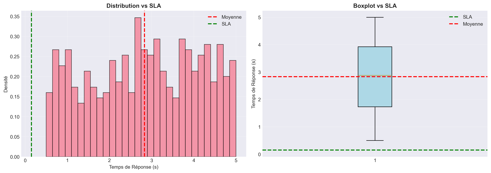
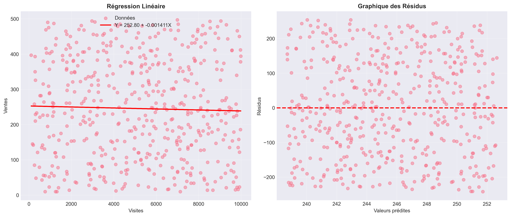

# 📈 Analyse statistique e-commerce – Temps de réponse et performance


Mini-projet de **Data Science** (Bachelor 3 Data, Ynov Campus) : analyse statistique de **500 observations**
issues d'un site e-commerce pour comprendre le lien entre trafic, ventes, clics et **temps de réponse serveur**,
et identifier les goulots d'étranglement.

## 🔍 Démarche

| Étape | Méthodes |
|---|---|
| 1. Exploration | Chargement, valeurs manquantes, types |
| 2. Statistiques descriptives | Moyenne, médiane, écart-type, quartiles, asymétrie |
| 3. Ajustement de lois | Tests de normalité (Shapiro-Wilk, Kolmogorov-Smirnov), loi normale et exponentielle |
| 4. Régression linéaire | Ventes en fonction des visites, R², RMSE |
| 5. Test de Student | Test à un échantillon : temps de réponse moyen comparé à l'objectif SLA |
| 6. Test du Khi-deux | Indépendance entre niveaux de visites et niveaux de clics, V de Cramer |

## 📌 Résultats

| Analyse | Résultat | Lecture |
|---|---|---|
| Statistiques descriptives | Visites μ = 5 127 · Ventes μ = 246 · Temps de réponse μ = 2,83 s | Forte dispersion du trafic |
| Régression Ventes ~ Visites | r = −0,03, R² = 0,001 | Le trafic seul n'explique pas les ventes |
| Test de Student (SLA) | t = 46,3, p < 0,001 | Temps de réponse moyen significativement au-dessus de l'objectif : SLA non respecté |
| Test du Khi-deux (visites × clics) | χ² = 9,28, p = 0,16, V de Cramer = 0,10 | Pas de dépendance significative : H0 acceptée |

| Tests statistiques | Régression |
|---|---|
|  |  |

## ▶️ Lancer l'analyse

```bash
pip install -r requirements.txt
python main.py          # affiche les étapes et génère les graphiques
```

Les résultats détaillés sont dans `resultats_analyse.txt`, le rapport complet et la présentation dans `docs/`.

## 🛠️ Compétences

`Python` · `pandas` · `NumPy` · `SciPy` · `scikit-learn` · `Matplotlib` · `Seaborn` ·
`tests d'hypothèses` · `régression linéaire` · `ajustement de lois`

---
Khadija Ibisk – Bachelor Dev IA & Data Engineering, Ynov Campus
